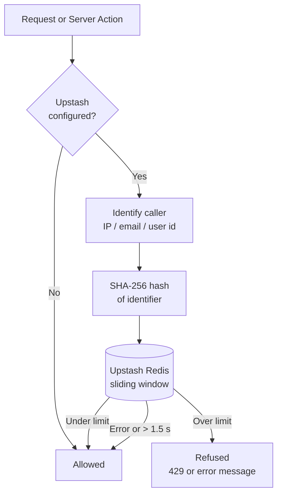

# Rate Limiting

## Overview

The portal limits how often the riskiest endpoints and Server Actions can be called, to stop scraping, brute-force sign-in attempts, invitation spam, and abuse of the free external university-search API.

Counters are kept in **[Upstash Redis](https://upstash.com/)** through the [`@upstash/ratelimit`](https://github.com/upstash/ratelimit-js) library. A shared store is required because the app runs on Vercel, where every request may be served by a different, stateless function instance: an in-memory counter would only limit each instance separately and would stop working exactly when traffic spikes. Upstash is reached over HTTPS (no persistent connection), which suits serverless functions, and its free tier covers this app's traffic.

Everything lives in one module, `src/lib/rate-limit.ts`. Routes and actions never create their own Redis client; they call the module's helpers, which share configuration and instances.

## What Is Limited

All limits use a **sliding window**.

| Surface | Limit | Counted per | Why this number |
| :------ | :---- | :---------- | :-------------- |
| Public API — all six `/api/public/*` routes | 120 requests / minute | IP address | Generous enough for a school computer lab browsing the public site from one shared IP; stops scripts making thousands of calls a minute. |
| `login` | 10 / 15 min **and** 300 / 15 min | email **and** IP | The email limit stops one account being guessed from many IPs. The IP limit is high because an entire school signs in from one IP when a round opens. |
| `signup` | 5 / hour **and** 100 / hour | email **and** IP | Allows a whole class to claim invites from a school network at once. |
| `requestPasswordReset` | 3 / hour **and** 20 / hour | email **and** IP | Each request sends a real email. |
| `resetPassword` | 20 / hour | IP | Already requires a valid recovery session, so this is a light cap. |
| `GET /api/schools/suggest?type=university` | 30 / minute | signed-in user | The school picker waits 250 ms after typing stops, so a real person makes a handful of lookups a minute. Protects the free hipolabs API for every user. `type=high_school` searches a local file and is not limited. |
| Invitation emails — `createPortal`, `sendInvitations`, `addEducators`, `inviteStudents` | 1 000 recipients / hour | signed-in user (shared across all four) | Counted per **recipient**, not per click, so one large CSV upload counts the same as many small batches. A single batch above 1 000 is rejected with a request to split it. |

For login, signup and password-reset requests, **both** limits apply and the request is refused if either is exceeded. The email limit is checked *before* any account lookup, so being limited never reveals whether an address has an account.

### Deliberately not limited

| Endpoint | Reason |
| :------- | :----- |
| `GET /api/health` | Uptime monitors and CI must be able to call it freely. |
| `/api/webhooks/round-scheduler` | Protected by the `CRON_SECRET` bearer token, and the sweep is idempotent, so repeated or overlapping cron and manual calls are harmless. A count limit would only block legitimate triggers. |
| `/api/student/sitting/start`, `save`, `sync`, `submit` | Students must never be locked out mid-exam. `save` is called on **every** answer change with no debounce — once per keystroke in free-text answers — and replays all queued answers in a burst after reconnecting. If `submit` fails at the deadline, the exam timer retries it every second. Any practical limit risks blocking a student at the worst moment. These routes are authenticated and scoped to the caller's own sitting. |

## How It Works



- **API routes** return HTTP `429 Too Many Requests` with a JSON body and a `Retry-After` header (seconds). Public API responses keep the wildcard CORS header, so browser clients can read the error.
- **Server Actions** return `{ error: "..." }`, the same shape as every other action error, so existing forms display it with no changes. Example: *"Too many attempts. Please wait 10 minutes and try again."*
- **Checked first.** Every limit is checked before the route or action does any real work — no database query, Supabase call, external API call or email happens for a refused request.
- **Caller IP** comes from `x-real-ip`, falling back to the first entry of `x-forwarded-for`. On Vercel these headers are set by the platform, not the client. If the app is ever hosted behind a different proxy, this needs reviewing.
- **Privacy.** Emails, IPs and user ids are hashed with SHA-256 before being sent to Upstash, so no raw personal data is stored there.

### Failing open

The limiter is designed so that a problem with it can never take the portal down:

- If `UPSTASH_REDIS_REST_URL` or `UPSTASH_REDIS_REST_TOKEN` is missing, **rate limiting is turned off** and every request is allowed. In production a warning is logged.
- If Redis returns an error, or doesn't answer within **1.5 seconds**, the request is allowed and the error is logged.

The trade-off: if the variables are missing in production, the portal is silently unprotected. Always check they are set after deploying.

## Environment Variables

| Variable | Required | Description |
| :------- | :------- | :---------- |
| `UPSTASH_REDIS_REST_URL` | Production | REST URL of the Upstash Redis database, e.g. `https://xxxx.upstash.io`. |
| `UPSTASH_REDIS_REST_TOKEN` | Production | REST token for that database. Treat it as a secret. |

:::note
Leave both unset in local development and tests: rate limiting is simply disabled. The test setup (`vitest.setup.ts`) clears them explicitly, so the test suite can never reach a real Redis instance.
:::

## Setup Guide

1. Create an Upstash Redis database, either through the Upstash integration in the Vercel Marketplace or directly at [console.upstash.com](https://console.upstash.com).
2. Copy the database's **REST URL** and **REST token**.
3. Add them as `UPSTASH_REDIS_REST_URL` and `UPSTASH_REDIS_REST_TOKEN` in the Vercel project's environment variables (the Vercel integration can add them for you).
4. Redeploy. No database migration is needed.

## Changing a Limit

All limits are defined in the `RATE_LIMITS` table at the top of `src/lib/rate-limit.ts`:

```ts
export const RATE_LIMITS = {
  publicApi: { limit: 120, window: '1 m' },
  loginEmail: { limit: 10, window: '15 m' },
  // ...
};
```

Edit the `limit` or `window` there and redeploy. Each limit stores its counters under its own Redis prefix (`olympiad-rl:<name>`), so limits never interfere with each other.

## Testing

- `tests/lib/rate-limit.test.ts` tests the module against a mocked Upstash client: disabled when unconfigured, identifier hashing, recipient-weighted invite counting, retry delays, failing open on errors, and IP header parsing.
- `tests/app/rate-limited-surfaces.test.ts` mocks `@/lib/rate-limit` to refuse, and checks that the public API, university suggestions, `login` and `inviteStudents` each stop before doing any work and report the limit in the expected shape.

## Gotchas

- **Targeted lockout.** Because login is limited per email, someone can keep a particular user from signing in by deliberately making 10 failed attempts every 15 minutes. This is the usual trade-off of per-account limits.
- **Shared school networks.** Many students behind one school IP share the per-IP limits. These were set high for that reason; raise them if a large school reports being blocked when a round opens.
- **Email quota is lower.** The Brevo free tier allows 300 emails per day (see [Email (SMTP)](./email-smtp.mdx)), well below the 1 000-per-hour invitation limit, so Brevo's quota will usually be reached first.
- **Supabase's own limits don't replace these.** Sign-in calls reach Supabase from the Vercel server, so Supabase sees the server's IP rather than the user's.
